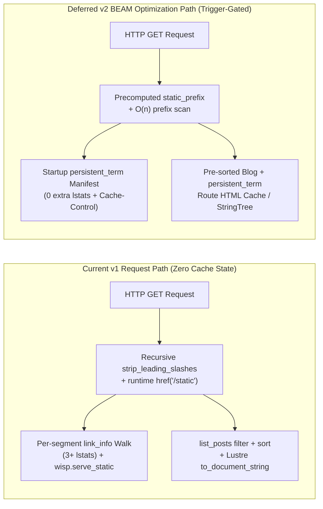

# EFFICIENCY-0001: Wisp + Lustre Bento Architecture Efficiency Audit

- **Date:** 2026-11-19
- **Status:** Document-Only Advisory Report (Stage 4 of `/tdd-and-blind-audit`)
- **Related ADR:** [ADR-0001: Multi-Page Wisp + Lustre Bento Architecture](../decisions/ADR-0001-multi-page-wisp-lustre-bento-architecture.md)
- **Verification Baseline:** `74 / 74` unit, integration, and Birdie snapshot tests passing; Stage 2 Cross-Family Blind Review (`Claude Sonnet 5.5 High`) clean; Stage 3 Cross-Family Security Loop (`Claude Opus 5.5 High` Passes #1 & #3 ↔ `Gemini 4 Neon XHigh` Pass #2) verified `findings: []`; Stage 4 Read-Only Efficiency Audit (`Claude Sonnet 5.5 High`) completed with zero code edits.

---

> [!WARNING]
> **Two Legacy Binary Asset Defects Verified Directly on Disk (`E1` & `E2`):**
> Inspections using `ls -lh` and `file` on legacy assets committed in initial revision `7bdde1e7` uncovered two non-code issues queued into [`ROADMAP.md`](../../ROADMAP.md) (`B1.5` & `B1.6`):
> 1. **`E1` (`priv/static/me.jpg`)**: Currently `256K` (`2944×2208`, Samsung `SM-G973F`) and contains **`GPS-Data` EXIF metadata**, while rendered as an `88×88 px` hero portrait (`fetchpriority="high"`). Stripping metadata and resizing to `176×176` (`~5–8 KB`) eliminates both the EXIF privacy leak and `~97%` of critical LCP image bytes.
> 2. **`E2` (`priv/static/fonts/JetBrainsMono-Regular.woff2`)**: `file` reports `"HTML document text"` containing a Google `Error 404 (Not Found)` HTML page (`4.0K` allocated / `~1.6 KB`) rather than a valid `.woff2` binary, causing a wasted preloaded request on every page view before falling back to system monospace.

---

## 1. Optimization Opportunities & Trigger Thresholds

*All complexity and speedup estimates below are derived from static inspection (`eff-audit`) and direct filesystem measurements (`ls -lh`, `file`), not runtime load benchmarks.*

| ID | Location (`file:line`) | Current Complexity / Behavior | Proposed Optimization | Estimated Gain vs. Complexity Trade-Off | Trigger Condition |
| :--- | :--- | :--- | :--- | :--- | :--- |
| **E1** | [`home.gleam#L44-L50`](../../src/dev_ing_website/pages/home.gleam#L44-L50), `priv/static/me.jpg` | `256K` (`2944×2208`) JPEG with Samsung `GPS-Data` EXIF rendered at `88×88 px` | Strip EXIF metadata and resize to `176×176` (`2x`) WebP/JPEG | **High (~97% LCP image reduction + privacy fix)** / Zero code complexity | **Already tripped** (`>100 KB` asset + `GPS-Data` EXIF present; queued as `B1.5`) |
| **E2** | [`layout.gleam#L52-L61`](../../src/dev_ing_website/layout.gleam#L52-L61), [`styles.css#L1-L7`](../../priv/static/styles.css#L1-L7) | Preloads `JetBrainsMono-Regular.woff2`, which on disk is a Google 404 HTML page | Replace with valid Latin-subset `.woff2` (`~15–25 KB`) or remove broken `@font-face` + preload | **High (eliminates 404 font decode error & wasted preload)** / Trivial change | **Already tripped** (corrupt legacy asset; queued as `B1.6`) |
| **E3** | [`export.gleam#L76-L81`](../../src/dev_ing_website/export.gleam#L76-L81), `priv/static/` (`2.0M` total) | `copy_directory_strict` copies all `2.0M` (`under-construction.png` `1.0M`, `glelements.css` `4.6K`, 28 unused icons `~700 KB`) | Prune dead assets or export an explicit asset manifest; resize icons to `<= 96 px` (`~2–4 KB`) | **High (~83% smaller static bundle)** / Low coupling via manifest | **Already tripped** (`>100 KB` unreferenced static payload; deferred to `S3.5`) |
| **E4** | [`router.gleam#L431-L444`](../../src/dev_ing_website/router.gleam#L431-L444) | Live Wisp server sends no `Cache-Control` headers or precompressed `.br`/`.gz` responses | Add `Cache-Control: public, max-age=300, must-revalidate` for HTML, `max-age=86400` (or hashed `immutable`) for static files, and gzip/brotli middleware | **High (~100% repeat static byte savings, ~70% smaller HTML/CSS)** / Medium trade-off (cache busting) | **When hosting live BEAM server (`F2.2`)** or `>50 req/s` / `>100 KB` uncompressed first view (`S3.6`) |
| **E5** | [`router.gleam#L204-L218`](../../src/dev_ing_website/router.gleam#L204-L218), [`router.gleam#L344-L406`](../../src/dev_ing_website/router.gleam#L344-L406) | Walks `link_info` per path segment (`3+` lstats) before `wisp.serve_static` re-stats (~25–40 FS ops/page) | In prod mode, build a startup symlink-free static file manifest in `persistent_term`/ETS and verify via O(1) lookup | **Medium (~70% fewer static FS syscalls)** / Medium trade-off (startup state, dev bypass) | **Sustained `>500 static req/s`** or `>50 page views/s` on live BEAM host (`S3.7`) |
| **E6** | [`router.gleam#L424-L429`](../../src/dev_ing_website/router.gleam#L424-L429), [`router.gleam#L196-L202`](../../src/dev_ing_website/router.gleam#L196-L202) | Recursive `strip_leading_slashes` calls `string.drop_start(value, 1)` on untrusted `req.path`, and `context.href` recomputes `static_prefix` per request | Replace with single-pass prefix scan / `list.drop_while`; precompute `static_prefix` once at startup | **Low-Medium (eliminates O(n^2) slash-run CPU cost)** / Trivial complexity | **Untrusted paths `>1,000` chars at `>20 req/s`** (`S3.8`) |
| **E7** | [`export.gleam#L239-L287`](../../src/dev_ing_website/export.gleam#L239-L287) | `list.append(acc, [dest_path])` inside `try_fold` (`O(k^2)` per directory) | Prepend `[dest_path, ..acc]` and `list.reverse` once per directory | **Low at 38 files (`O(n^2) -> O(n)` at scale)** / Trivial complexity | **`>2,000` files in one directory** or `>10,000` total static files (`S3.9`) |
| **E8** | [`export.gleam#L59-L73`](../../src/dev_ing_website/export.gleam#L59-L73), [`router.gleam#L162-L170`](../../src/dev_ing_website/router.gleam#L162-L170) | Sequential writes and duplicate `render_route(ctx, Resume)` for `/resume` and `/about` | Reuse rendered HTML across route aliases; parallelize I/O only at scale | **Low (~8% SSR export time saved)** / Trivial alias reuse | **Export wall time `>2 s`** or `>500` pages / `>1,000` files (`S3.9`) |
| **E9** | [`blog.gleam#L24-L47`](../../src/dev_ing_website/data/blog.gleam#L24-L47), [`home.gleam#L21`](../../src/dev_ing_website/pages/home.gleam#L21) | `list_posts` filters + sorts `O(P log P)` on every call (including `find_by_slug`); Home lists all visible posts | Keep `all_posts()` pre-sorted descending; make `find_by_slug` skip sorting (`O(P)`); cap Home via `list.take(posts, 3)` | **Low at `P=3`, Medium at scale (`O(P^2 log P)` export saved)** / Low complexity | **`>5` posts on Home** (cap view) or **`>100` posts** (`S3.9`) |
| **E10** | [`router.gleam#L255-L262`](../../src/dev_ing_website/router.gleam#L255-L262) | Rebuilds Lustre `Element` tree and flattens `element.to_document_string` on every request | Step 1: stream `to_document_string_tree` via `wisp.string_tree_body`; Step 2: memoize prod HTML by `Route` in `persistent_term` | **Medium-High (~5–10% Step 1; ~95% Step 2 render time cut)** / Low-Medium complexity (dev bypass) | **`>50 page req/s per core`** or HTML documents `>100 KB` (`S3.9`) |
| **E11** | [`context.gleam#L94-L139`](../../src/dev_ing_website/context.gleam#L94-L139), [`theme.gleam#L82-L98`](../../src/dev_ing_website/theme.gleam#L82-L98) | `context.href` re-sanitizes static/internal paths and `normalize_base_path` on every call; `resolve_card_class` joins strings per card | Precompute normalized `base_path` and static URLs; pre-resolve repeated card class strings if needed | **Negligible (`~1–3 µs`/call today)** / Premature unless hot | **`>1,000 page req/s`** or `>200` links / `>500` cards per page (`S3.9`) |

---

## 2. Visual Path & Quantitative Comparison

### Current v1 Hot Path vs. Deferred v2 Optimization Path

### Estimated Relative Hot-Path Cost (`xychart-beta`, Baseline = 100, Lower is Better)

```mermaid
xychart-beta
  title "Estimated Relative Cost: v1 Baseline (100) vs Deferred Step 2 Optimizations"
  x-axis ["SSR Render", "Static Syscalls", "Data Lookup", "Exporter I/O", "Bundle Bytes"]
  y-axis "Relative Cost (Estimate, Lower is Better)" 0 --> 100
  bar [100, 100, 100, 100, 100]
  bar [5, 25, 10, 6, 2.5]
```

*(First bar per category = v1 baseline normalized to `100`; second bar = estimated relative cost after deferred Step 2 optimizations `E1`–`E10`.)*

---

## 3. Summary of Cross-Family Blind Verification (Stages 2–4)

- **Stage 2 (`blind-rev` — `Claude Sonnet 5.5 High`)**: Verified 0 blockers and 0 feature-gating leaks; uncovered 4 test-coverage gaps and CSS/heading/ordering polish items, addressed via 36 new atomic tests (`60/60` passing).
- **Stage 3 Pass #1 (`sec-pass-1` — `Claude Opus 5.5 High`)**: Verified 0 critical/high/medium flaws and surfaced 6 low/info hardening items (`DEV_ING_ENV` safe production default, `export_site` non-empty output refusal, dotfile filtering, outer `apply_security_headers` + `<meta>` CSP, `context.href` control-char/`\\` sanitization, static segment boundaries).
- **Stage 3 Pass #2 (`sec-pass-2` — `Gemini 4 Neon XHigh`)**: Found 4 genuine POSIX/symlink vulnerabilities (`SEC-P2-01`..`SEC-P2-04`) across `wisp.serve_static`, `copy_directory_strict`, trailing-slash `lstat`, and nested `output_dir` recursion; all 4 reproduced in failing Red tests and fixed (`74/74` passing).
- **Stage 3 Pass #3 (`sec-pass-3` — `Claude Opus 5.5 High`)**: Re-audited all 18 updated production/config files and confirmed `findings: []`.
- **Stage 4 (`eff-audit` — `Claude Sonnet 5.5 High`)**: Read-only efficiency audit captured in `E1`–`E11` above with zero code edits.
