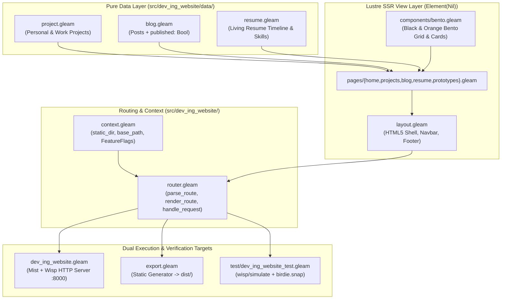
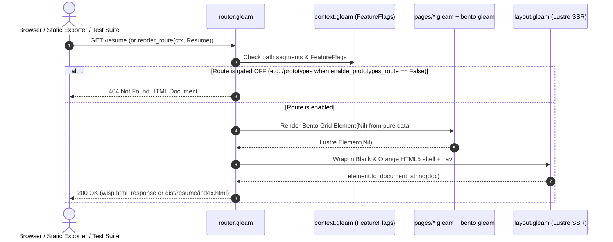

# ADR-0001: Multi-Page Wisp + Lustre Bento Architecture & Hybrid Static Exporter

- **Status:** Draft (Phase 1 Discovery Complete — Entering Phase 2 Spikes)
- **Date:** 2026-11-18
- **Author:** Callum Ingley & Antigravity (`architect-plan`)

---

## 1. Context & Problem Statement

The legacy `dev_ing` website ([kazlim-code/dev-ing](https://github.com/kazlim-code/dev-ing)) was built as a single-page application (SPA) in Gleam (`v1.13.0`) and Lustre (`v5.4.0`) using client-side routing (`modem`). While effective as an initial exploration, client-side SPA routing on GitHub Pages requires `404.html` redirect workarounds, couples data models to client `Msg`/`Attribute(a)` types, and does not exercise server-side Gleam on the BEAM (`wisp` + `mist`).

**How might we** architect `dev_ing_website` from the ground up in **Gleam (`v1.18.1`)**, **Wisp (`v2.2.2`)**, and **Lustre (`v5.7.1`)** as a clean, minimal **Black & Orange Bento-Grid multi-page application (MPA)**—featuring a personal learning showcase and a dedicated **Living Resume** (`/resume`)—that runs as a live Wisp server locally (and on future BEAM hosts in v2) while exporting static multi-page HTML (`dist/`) for GitHub Pages in v1?

---

## 2. Phase 1 Multimodal & Repo Slicing Findings

### Slice A — Data & Content Schema Findings
- **Pure Data Separation (`B1.2`)**: Legacy `lib/project.gleam` defined `Project(a)` with an embedded `icon_class: Option(Attribute(a))`, polluting pure data modules with Lustre view types. All v1 data modules (`data/project.gleam`, `data/blog.gleam`, `data/resume.gleam`) will be 100% pure Gleam types.
- **Draft / Published Post Gating (`B1.3`)**: Legacy `data/blog.gleam` commented out the `what-is-jj` post. In v1, `BlogPost` includes `published: Bool`, gated by `Context.features.enable_unpublished_posts`.
- **Living Resume Content (`/tmp/resume.md`)**: Full career timeline (Grafa 2025–2026, Wyrd Technology 2024–2025, Grafa 2021–2024, Akora Property 2018–2020, The West Australian 2010–2018, UWA BSc Computer & Mathematical Sciences) will power `/resume` (with street address/phone omitted for privacy).

### Slice B — Wisp `v2.2.2` & Lustre `v5.7.1` Interface Findings
- **`wisp/simulate` Replaces `wisp/testing`**: In `wisp v2.2.2`, `wisp/testing` no longer exists; route simulation uses `wisp/simulate` (`simulate.request(http.Get, path)` and `simulate.read_body(response)`).
- **Lustre SSR & Birdie Formatting**: `lustre/element.to_document_string(el)` renders full HTML5 documents (`<!doctype html>\n...`), while `element.to_readable_string(el)` formats multi-line HTML ideal for `birdie.snap(content:, title:)`.
- **Direct `simplifile` Dependency**: Added `simplifile >= 2.7.0` directly to `gleam.toml` so `export.gleam` can write `dist/` trees and copy `priv/static/` assets cleanly.

### Slice C — Theme Tokens, Conventions & Feature Flags
- **Black & Orange Palette**: `priv/static/glelements.css` maps `--color-primary` to `orange-500` (`#f97316`) and `--color-surface-900`/`950` to `zinc-900` (`#18181b`) / `zinc-950` (`#09090b`), paired with `JetBrainsMono-Regular.woff2`.
- **Feature Flags in `Context`**: `FeatureFlags(enable_prototypes_route: Bool, enable_unpublished_posts: Bool, enable_resume_filters: Bool)` defaults to `False` in production static exports (`prod_defaults()`) and `True` in local development (`dev_defaults()`).

---

## 3. Visual System Map (Phase 1)

### System Boundary Flowchart

### Request & Static Export Sequence Diagram

---

## 4. Phase 2 Candidate Architectures for Static Export & Routing

Two candidate architectures are being prototyped in isolated `workspace: "share"` worktrees:

1. **Candidate A — Shared Pure Renderer (`render_route`)**:
   - `router.gleam` exposes `render_route(ctx: Context, route: Route) -> #(Int, Element(Nil))` (or `#(Int, String)`).
   - `handle_request` wraps `render_route` in Wisp middleware (`serve_static`, `log_request`, `rescue_crashes`) and `wisp.html_response`.
   - `export.gleam` enumerates typed `Route` values and calls `render_route` directly without importing test-only `wisp/simulate` in `src/`.
2. **Candidate B — Wisp HTTP Loopback Exporter (`wisp/simulate`)**:
   - `export.gleam` synthesizes HTTP GET requests via `wisp/simulate.request(http.Get, path) |> router.handle_request(ctx)` and extracts `simulate.read_body(response)`.
