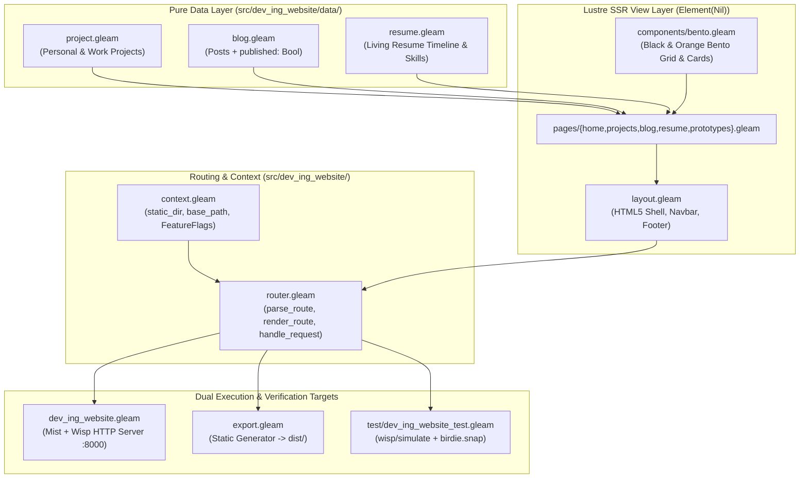
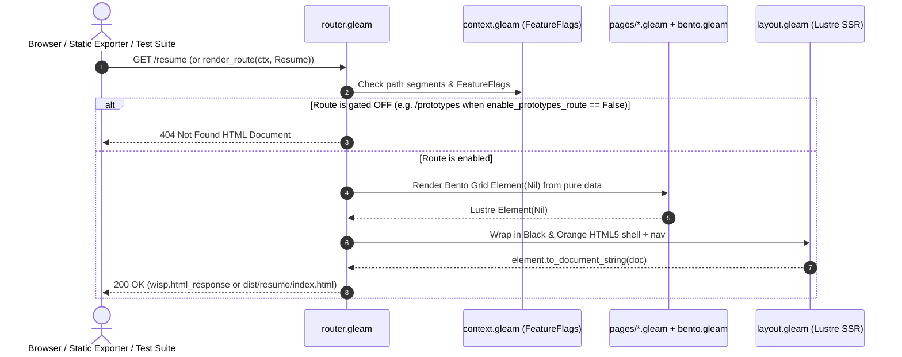
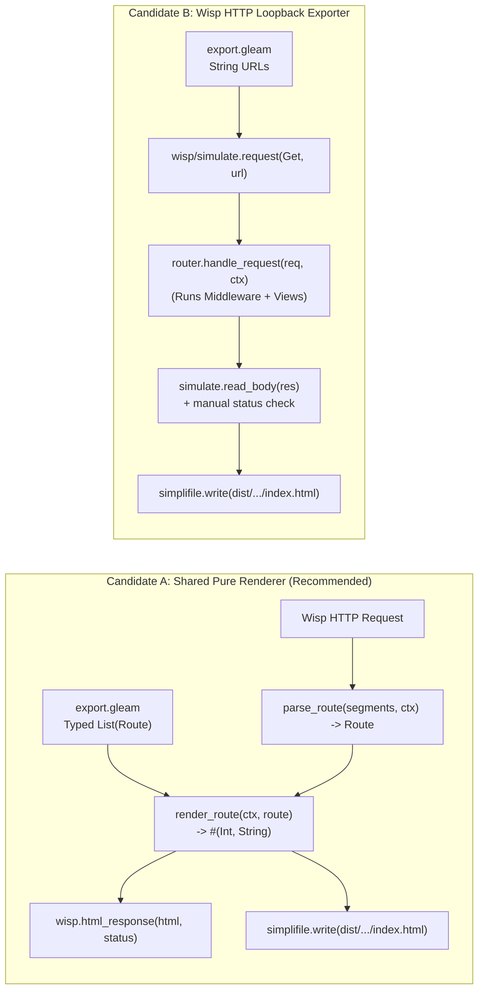

# ADR-0001: Multi-Page Wisp + Lustre Bento Architecture & Hybrid Static Exporter

- **Status:** Draft (Phase 1 Discovery Complete — Entering Phase 2 Spikes)
- **Date:** 2026-11-18
- **Author:** Callum Ingley & Antigravity (`architect-plan`)

---

## 1. Context & Problem Statement

The legacy `dev_ing` website ([kazlim-code/dev-ing](https://github.com/kazlim-code/dev-ing)) was built as a single-page application (SPA) in Gleam (`v1.13.0`) and Lustre (`v5.4.0`) using client-side routing (`modem`). While effective as an initial exploration, client-side SPA routing on GitHub Pages requires `404.html` redirect workarounds, couples data models to client `Msg`/`Attribute(a)` types, and does not exercise server-side Gleam on the BEAM (`wisp` + `mist`).

**How might we** architect `dev_ing_website` from the ground up in **Gleam (`v1.18.1`)**, **Wisp (`v2.2.2`)**, and **Lustre (`v5.7.1`)** as a clean, minimal **Black & Orange Bento-Grid multi-page application (MPA)**—featuring a personal learning showcase and a dedicated **Living Resume** (`/resume`)—that runs as a live Wisp server locally (and on future BEAM hosts in v2) while exporting static multi-page HTML (`dist/`) for GitHub Pages in v1?

---

## 2. Phase 1 Multimodal & Repo Slicing Findings

### Slice A — Data & Content Schema Findings
- **Pure Data Separation (`B1.2`)**: Legacy `lib/project.gleam` defined `Project(a)` with an embedded `icon_class: Option(Attribute(a))`, polluting pure data modules with Lustre view types. All v1 data modules (`data/project.gleam`, `data/blog.gleam`, `data/resume.gleam`) will be 100% pure Gleam types.
- **Draft / Published Post Gating (`B1.3`)**: Legacy `data/blog.gleam` commented out the `what-is-jj` post. In v1, `BlogPost` includes `published: Bool`, gated by `Context.features.enable_unpublished_posts`.
- **Living Resume Content (`/tmp/resume.md`)**: Full career timeline (Grafa 2025–2026, Wyrd Technology 2024–2025, Grafa 2021–2024, Akora Property 2018–2020, The West Australian 2010–2018, UWA BSc Computer & Mathematical Sciences) will power `/resume` (with street address/phone omitted for privacy).

### Slice B — Wisp `v2.2.2` & Lustre `v5.7.1` Interface Findings
- **`wisp/simulate` Replaces `wisp/testing`**: In `wisp v2.2.2`, `wisp/testing` no longer exists; route simulation uses `wisp/simulate` (`simulate.request(http.Get, path)` and `simulate.read_body(response)`).
- **Lustre SSR & Birdie Formatting**: `lustre/element.to_document_string(el)` renders full HTML5 documents (`<!doctype html>\n...`), while `element.to_readable_string(el)` formats multi-line HTML ideal for `birdie.snap(content:, title:)`.
- **Direct `simplifile` Dependency**: Added `simplifile >= 2.7.0` directly to `gleam.toml` so `export.gleam` can write `dist/` trees and copy `priv/static/` assets cleanly.

### Slice C — Theme Tokens, Generic Component Architecture & Feature Flags
- **Theme-Parameterized Generic Components (`theme.gleam` + `components/`)**: Rather than relying on the early external `glelements` POC repository, UI primitives (`bento.gleam`, cards, badges, section headers) must be architected in-repo as generic, reusable functions that accept explicit typed theme and variant options (`Theme`, `CardTone`, `BentoSpan`, `BadgeVariant`). This guarantees every component can be unit- and Birdie-snapshot tested in isolation and makes prototyping fun, expressive design systems in v2 (`F2.1`) and a standout interactive Living Resume (`F2.3`) seamless.
- **Black & Orange Default Palette**: `priv/static/glelements.css` maps `--color-primary` to `orange-500` (`#f97316`) and `--color-surface-900`/`950` to `zinc-900` (`#18181b`) / `zinc-950` (`#09090b`), paired with `JetBrainsMono-Regular.woff2`.
- **Feature Flags in `Context`**: `FeatureFlags(enable_prototypes_route: Bool, enable_unpublished_posts: Bool, enable_resume_filters: Bool)` defaults to `False` in production static exports (`prod_defaults()`) and `True` in local development (`dev_defaults()`).

---

## 3. Visual System Map (Phase 1)

### System Boundary Flowchart

### Request & Static Export Sequence Diagram

---

## 4. Phase 2 Empirical Prototype Spike Comparison

### Conceptual Overview: What Problem the Two Spikes Solved & What `wisp/simulate` Does

In v1, `dev_ing_website` runs in **two execution modes** from the same codebase:
1. **Live Wisp Server (`gleam run`)**: Serves pages dynamically over HTTP at `http://localhost:8000` (and on a live BEAM server in v2).
2. **Static Exporter (`gleam run -m dev_ing_website/export`)**: Generates static `.html` files into `dist/` (`dist/index.html`, `dist/resume/index.html`, etc.) for zero-cost **GitHub Pages** hosting.

The two spikes tested two different mechanisms for `export.gleam` to generate those static HTML files:

- **What `wisp/simulate` Is**:
  - Normally, a `wisp.Request` is created by the **Mist** web server when a browser opens a real TCP socket. Because `wisp.Request` wraps an opaque internal network connection type, you cannot construct one directly with `Request(...)`.
  - **`wisp/simulate`** (called `wisp/testing` in Wisp v1) is Wisp's built-in **mock HTTP utility** for testing a Wisp server in memory without opening a network port:
    - `simulate.request(http.Get, "/resume")` constructs a synthetic in-memory `wisp.Request` (using a dummy host `wisp.example.com` and a test secret key).
    - Passing that request to `router.handle_request(req, ctx)` returns a `wisp.Response`.
    - `simulate.read_body(response)` extracts the rendered HTML `String` from the response body.
- **Candidate B ("Fake HTTP Loopback" via `wisp/simulate`)**:
  - **How it works**: `export.gleam` imports `wisp/simulate` inside `src/`, pretends to be a browser sending synthetic `GET` requests (`"/resume"`, `"/projects"`, etc.) to `router.handle_request`, and writes `simulate.read_body(response)` to `dist/`.
  - **Why it was considered**: The static export exercises the exact same HTTP entry point (`handle_request`), URL path-segment splitter, and Wisp middleware stack (`log_request`, `rescue_crashes`) as a live browser request.
  - **Downsides uncovered in the spike**:
    1. Pulls a test-oriented helper (`wisp/simulate`) into production `src/` code.
    2. Stringly-typed: `export.gleam` must iterate over raw URL strings and manually check `response.status == 200` (or `404` for `404.html`).
    3. Every exported page triggers Wisp's console request logger and crash-rescue middleware (which could silently write a `500 Internal Server Error` page into `dist/` if a view panicked).
- **Candidate A ("Shared Pure Function" via `render_route`)**:
  - **How it works**: Separates **HTML generation** from **HTTP transport**:
    - `render_route(ctx, Resume)` is a pure Gleam function taking a typed `Route` variant (`Home`, `Projects`, `Blog`, `Resume`, etc.) and returning `#(200, "<!doctype html>...")`.
    - **Wisp (`handle_request`)** parses the URL into a `Route`, calls `render_route`, and wraps the string in `wisp.html_response`.
    - **Static Exporter (`export.gleam`)** loops over a typed `List(Route)` and calls `render_route` directly—zero fake HTTP requests needed.
  - **Where `wisp/simulate` lives in Candidate A**: Strictly inside `test/dev_ing_website_test.gleam` to test HTTP routing, headers, and middleware.

*(See also: [docs/learnings/wisp-simulate-and-hybrid-static-export.md](file:///Users/callum/Documents/GitHub/dev_ing_website/docs/learnings/wisp-simulate-and-hybrid-static-export.md))*

Two isolated Jujutsu worktrees (`scratch/spike_a` and `scratch/spike_b`) prototyped the full core slice (`context`, `bento`, `layout`, `router`, `export`, and `dev_ing_website_test`) and executed `gleam test`:

### Side-by-Side Spike Metrics

| Metric / Dimension | Candidate A: Shared Pure Renderer (`render_route`) | Candidate B: Wisp Loopback Exporter (`wisp/simulate`) |
| :--- | :--- | :--- |
| **Total Lines of Code (`loc_changed`)** | **`678` LOC** (`~16%` more compact) | `804` LOC |
| **`router.gleam` + `export.gleam` LOC** | **`329` LOC** (`256` + `73`) | `426` LOC (`327` + `99`) |
| **Files Touched (`files_touched`)** | `6` files | `6` files |
| **Tests Passed (`gleam test`)** | **`4 / 4` passed** | `3 / 3` passed |
| **`wisp/simulate` in Production `src/`** | **None (`0` test imports in `src/`)** | Imported in `src/dev_ing_website/export.gleam` |
| **Type Safety of Export Targets** | **Compile-time typed `List(#(Route, String))`** | Runtime string URLs + manual `expected_status` checks |
| **Middleware Side Effects During Export** | **Zero** (`wisp.log_request` / `rescue_crashes` skipped cleanly) | Triggers HTTP request logging & masks crashes as 500 responses unless manually guarded |

### Quantitative Spike Comparison (`xychart-beta`)

```mermaid
xychart-beta
  title "Phase 2 Spike Metrics: Candidate A (Pure Renderer) vs Candidate B (Wisp Loopback)"
  x-axis ["Total LOC", "Router + Export LOC", "Prod Test-Module Imports (x100)", "Friction Points (x100)"]
  y-axis "Score (Lower is Better)" 0 --> 900
  bar [678, 329, 0, 200]
  bar [804, 426, 100, 400]
```

### Architecture Comparison Diagram

